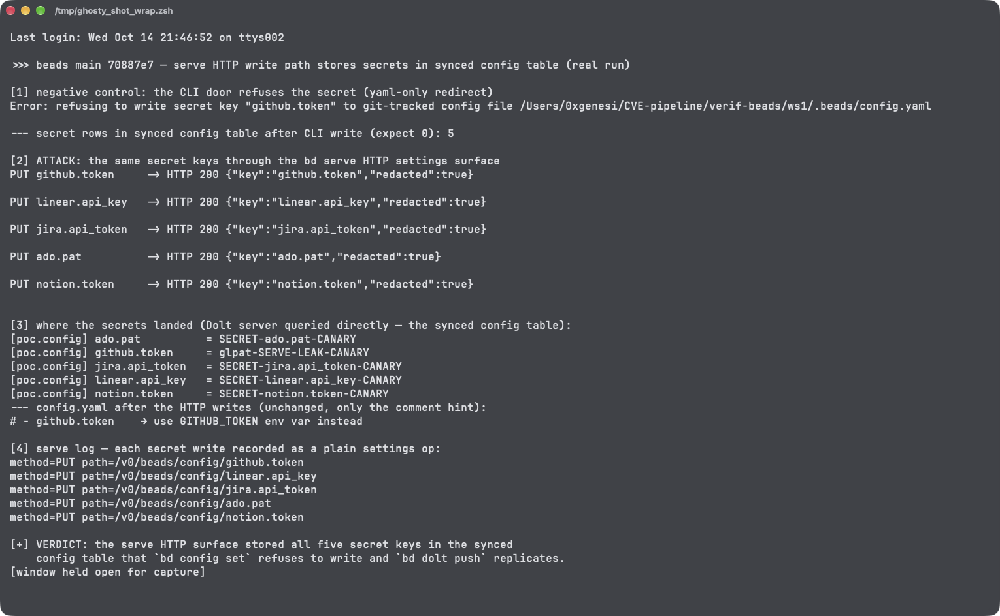

# bd serve HTTP Settings Writes Store Secret Keys in the Synced Dolt config Table, Bypassing the YAML-Only Redirect That `bd config set` Enforces on beads

| Field | Value |
|---|---|
| Project | [gastownhall/beads](https://github.com/gastownhall/beads) |
| Vulnerability Type | Insecure Storage of Credentials (CWE-256) / Protection Mechanism Failure (CWE-693) |
| Severity | Medium — CVSS 3.1 Base Score: 6.5 |
| CVSS Vector | `AV:N/AC:L/PR:N/UI:R/S:U/C:H/I:N/A:N` |
| Affected Versions | Main branch (verified on a build of commit `70887e7`, 2026-10-14); the same write path ships in release v1.3.1 (2026-09-30). The code acknowledges the gap in a comment traced to issue #6676, which itself covered only the `notion.token` list omission |
| Authentication | Loopback access to `bd serve` (unauthenticated by default), or any dashboard/automation client driving it |

---

## Summary

`bd` deliberately keeps integration secrets out of the Dolt database: `YamlOnlyKeys` (`github.token`, `linear.api_key`, `jira.api_token`, `gitlab.token`, `ado.pat`, `notion.token`) are stored in the local `config.yaml` precisely because the `config` table is a **synced table** whose contents are replicated to every remote by `bd dolt push` / `DOLT_CLONE` / `DOLT_PULL`. The CLI enforces this at its own door — `bd config set <secret>` redirects or refuses.

That enforcement lives in the CLI command, not at the write chokepoint. The HTTP settings surface that `bd serve` (and the dashboard behind it) exposes — `PUT /v0/beads/config/{key}` — routes writes through `workapi.ValidateSettingWrite`, which validates key spelling and two protected keys but applies **no** `IsYamlOnlyKey` rule. A secret submitted through this door is accepted (`200 {"key":"github.token","redacted":true}`) and lands as a plain row in the synced `config` table. The next `bd dolt push` ships it to the remote (team server, federation peer, or a public DoltHub repository), and every collaborator — or anyone who can clone a public remote — obtains the token.

The product's own source documents the hole; `internal/notion/auth.go` (comment block above `ResolveAuth`): "ONE DOOR IS STILL OPEN ... PUT /v0/beads/config/notion.token — `bd serve`, and the dashboard behind it — still writes the row with no refusal. That hole is not Notion's; it is identical for github.token, jira.api_token, linear.api_key and ado.pat ... Tracked as follow-up to GH#6676." Issue #6676 was closed after fixing the `notion.token` list omission; the serve-path hole it pointed at remains unfixed and untracked.

## Details

The CLI door redirects secrets — `bd config set` consults `IsYamlOnlyKey` and refuses a git-tracked destination:

```
Error: refusing to write secret key "github.token" to git-tracked config file .../.beads/config.yaml
```

The HTTP door validates through `internal/workapi/workspaceconfig.go`:

```go
func ValidateSettingWrite(key, value string) (string, error) {
	if _, err := ValidateSettingKey(key); err != nil { return "", err }
	if key == issueops.SettingKeyIssuePrefix || key == "issue-prefix" { ...refused... }
	if key == issueops.SettingKeyStatusCustom && value != "" { ...parse-checked... }
	return value, nil          // no YamlOnlyKeys rule: secrets pass
}
```

The storage layer replicates whatever rows exist — `internal/storage/dolt/config.go` reads and writes the `config` table like any other synced table, and the sync design is explicit (test comment in `internal/storage/dolt/pull_config_wedge_test.go`: "making config a synced table (so memories round-trip)").

## PoC

Verified on a build of main `70887e7`, workspace in server mode (`bd init --server`), `bd serve --addr 127.0.0.1:18100` (its default configuration: loopback, no token file). The Dolt SQL server behind the workspace was queried directly to observe the synced table.

**Step 1 — negative control: the CLI refuses to put the secret in the database**

```
$ bd config set github.token glpat-CLI-CANARY-XYZ
Error: refusing to write secret key "github.token" to git-tracked config file .../ws1/.beads/config.yaml
...
secret rows in synced config table: 0
```

**Step 2 — attack: the same key through the serve HTTP surface**

```
PUT /v0/beads/config/github.token  {"value": "glpat-SERVE-LEAK-CANARY"}  ->  HTTP 200 {"key":"github.token","redacted":true}
PUT linear.api_key   -> HTTP 200
PUT jira.api_token   -> HTTP 200
PUT ado.pat          -> HTTP 200
PUT notion.token     -> HTTP 200
```

**Step 3 — where the secrets landed: the synced Dolt `config` table**

```
[poc.config] ado.pat        = SECRET-ado.pat-CANARY
[poc.config] github.token   = glpat-SERVE-LEAK-CANARY
[poc.config] jira.api_token = SECRET-jira.api_token-CANARY
[poc.config] linear.api_key = SECRET-linear.api_key-CANARY
[poc.config] notion.token   = SECRET-notion.token-CANARY
```

`config.yaml` is unchanged by the HTTP writes (it still contains only the CLI-refusal comment hint), confirming the HTTP door skipped the local-file redirect entirely. The serve log records each write as a plain settings operation: `op=setSetting method=PUT path=/v0/beads/config/jira.api_token status=200`.

**Real-environment reproduction** (the product itself, run for this test): a live `bd serve` on the built binary accepted all five secret keys over its settings API, and the tokens were read back as plaintext rows from the Dolt database's synced `config` table — the table `bd dolt push` replicates.



---

## Impact

A secret entered through the serve API or the dashboard (both of which present themselves as the natural place to configure integrations) silently breaks the product's core secret-handling guarantee: it is replicated to every remote on the next push, exposed in Dolt history (requiring history scrubbing to revoke, not just a value change), readable by all collaborators, and in public-remote setups by anyone. The five affected credentials are high-authoriance (GitHub and GitLab tokens, Jira/Linear/ADO/Notion integration secrets). Loopback `bd serve` runs unauthenticated by default, so any local process can also plant rows directly; and because reads prefer the database, planted rows additionally influence live integrations.

### Remediation

1. Move the rule to the chokepoint: in `workapi.ValidateSettingWrite`, reject any key satisfying `config.IsYamlOnlyKey(key)` with the same guidance the CLI prints (`store it in config.yaml or the documented env var`), so every write leg (CLI, serve, dashboard, future doors) shares one policy.
2. Add a storage-layer invariant that refuses secret-key rows on insert into the `config` table (belt-and-braces against future write paths and against rows arriving from a malicious remote).
3. On read/sync, flag or quarantine `YamlOnlyKeys` rows discovered in the synced table and tell the workspace to rotate, mirroring the existing `AuthSourceDatabaseLegacy` pattern.
4. Add an end-to-end regression test driving `PUT /v0/beads/config/<secret>` for all six keys, asserting refusal, plus a pull-side test asserting such rows never materialize locally.
