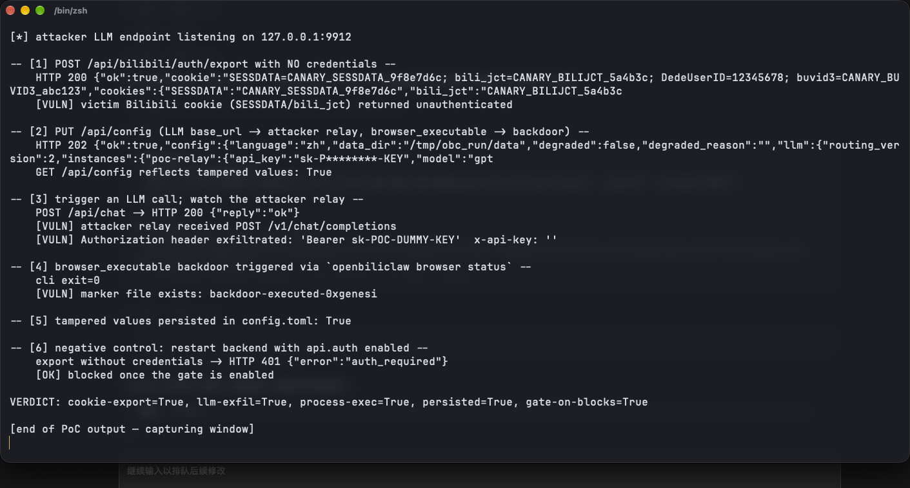

# Unauthenticated Bilibili Session-Credential Export in OpenBiliClaw Default Deployment

| Field | Value |
|---|---|
| Project | [whiteguo233/OpenBiliClaw](https://github.com/whiteguo233/OpenBiliClaw) |
| Vulnerability Type | Missing Authentication for Critical Function / Cleartext Storage of Session Credentials (CWE-306, CWE-312) |
| Severity | Critical — CVSS 3.1 Base Score: 9.1 |
| CVSS Vector | `AV:N/AC:L/PR:N/UI:N/S:U/C:H/I:H/A:N` |
| Affected Versions | <= 0.3.228 (verified on 0.3.228, latest release as of 2026-10-14; commit `94c2b28`) |
| Authentication | None |

---

## Summary

OpenBiliClaw's API binds to `0.0.0.0:8420` by default with the password gate disabled (`[api.auth] enabled = false` in the generated `config.toml`, matching `config.example.toml` and the port mapping in `docker-compose.yml`). The auth middleware short-circuits when the gate is off, so every API route is reachable without credentials. Among them, `POST /api/bilibili/auth/export` returns the complete stored Bilibili login cookie — including `SESSDATA`, `bili_jct`, and `DedeUserID`, obtained from the victim's QR-code login — in plaintext to any network peer. Unlike other credential-bearing routes (admin auth, init, tailnet credentials, migration export), this endpoint has no independent local-only check. A LAN peer (or anyone who can route to the exposed port) takes over the victim's Bilibili account with zero credentials.

## Details

The default configuration ships with the gate off and the listener exposed:

- `config.example.toml` → `[api.auth] enabled = false` (mirrored into the generated `config.toml` on first start)
- `docker-compose.yml` maps `8420:8420` for the backend service
- the server start command in `Dockerfile` is `openbiliclaw serve-api --host 0.0.0.0 --port 8420`

`src/openbiliclaw/api/auth.py` (0.3.228, `auth_guard` middleware):

```python
async def auth_guard(request: Request, call_next: Any) -> Any:
    gate: AuthGate = get_gate()
    if not gate.auth.enabled:
        return await call_next(request)      # gate off → everything passes
    if _is_public(request):
        return await call_next(request)
    if gate.is_trusted_local(request):
        return await call_next(request)
    ...
```

`src/openbiliclaw/api/app.py` (0.3.228, lines 8326-8360) implements the export route with no auth dependency and no local-only guard — it simply resolves the persisted cookie and returns it:

```python
@app.post("/api/bilibili/auth/export")
async def bilibili_auth_export() -> dict[str, Any]:
    """Export the backend's Bilibili cookie for the mobile app."""
    ...
    cookie = resolve_runtime_cookie(data_dir=cfg.data_path, configured_cookie=...)
    if not cookie:
        raise HTTPException(status_code=401, detail="Bilibili cookie not configured")
    ...
    return {"ok": True, "cookie": cookie, "cookies": cookies, ...}
```

The same unauthenticated surface includes full reads of the victim's content history and interest profile (`GET /api/content-history`, `GET /api/profile-summary`, `GET /api/events`, `GET /api/recommendations`), write actions performed with the victim's Bilibili session (`POST /api/bilibili/video/comment`, `/like`, `/coin`, `/follow`), and destruction of the login state (`DELETE /api/bilibili/auth/session`).

## PoC

Verified on release 0.3.228 (source tarball, commit `94c2b28`), installed with `uv pip install -e .` and started exactly as the Dockerfile does (`openbiliclaw serve-api --host 0.0.0.0 --port 8420`) with the stock generated configuration. A cookie in the canonical persisted format (containing canary values standing in for a real QR-login session) was placed in `data/bilibili_cookie.json`, the file the login flow writes. The client connects through the host's LAN address (a non-loopback peer, as a real attacker would).

**Step 1: export the victim's Bilibili cookie with no credentials**

```bash
python3 poc_unauth_export_and_config_tamper.py   # urllib client, section [1]
```
```
-- [1] POST /api/bilibili/auth/export with NO credentials --
    HTTP 200 {"ok":true,"cookie":"SESSDATA=CANARY_SESSDATA_9f8e7d6c; bili_jct=CANARY_BILIJCT_5a4b3c; DedeUserID=12345678; buvid3=CANARY_BUVID3_abc123",...}
    [VULN] victim Bilibili cookie (SESSDATA/bili_jct) returned unauthenticated
```

The returned `SESSDATA` value is the victim's Bilibili session credential; replaying it against `api.bilibili.com` authenticates as the victim, and `bili_jct` is the CSRF token required for state-changing requests (comments, likes, follows).

**Step 2: negative control — the same request once the password gate is enabled**

```
-- [6] negative control: restart backend with api.auth enabled --
    export without credentials -> HTTP 401 {"error":"auth_required"}
    [OK] blocked once the gate is enabled
```

**Real-environment reproduction** (the product itself, run for this test): the backend of release 0.3.228 was run locally with its default configuration on `0.0.0.0:8420`; all traffic above is real HTTP against the actual API, from a non-loopback source address, with no credentials supplied. The export returned the full stored cookie; enabling the gate (the non-default posture) blocks the identical request with 401.



---

## Impact

Any network peer that can reach port 8420 — home/office Wi-Fi guests, anyone on a shared hotspot segment, or internet attackers when the port is forwarded — can, without any credentials:

- **Take over the victim's Bilibili account** by replaying the exported `SESSDATA`/`bili_jct` cookies
- **Read the victim's private data**: watch history, interest profile, event stream, recommendations
- **Act as the victim on Bilibili** (post comments, like, coin, follow) via the panel's write endpoints that use the stored session
- **Destroy the login state** (`DELETE /api/bilibili/auth/session`)

### Remediation

1. Require authentication (or an explicit opt-in) before the API binds to `0.0.0.0`: generate a random password on first start, or bind to `127.0.0.1` by default like the CLI's own default.
2. Treat credential-export endpoints as privileged regardless of the gate: `POST /api/bilibili/auth/export` should require either an authenticated session or `is_trusted_local` like the other credential routes.
3. Return cookies only to explicitly paired mobile clients (e.g., a one-time pairing token), never to any caller of a plain POST.
4. Document loudly in `config.example.toml` and the README that disabling `[api.auth]` while exposing the port publishes the Bilibili session.
