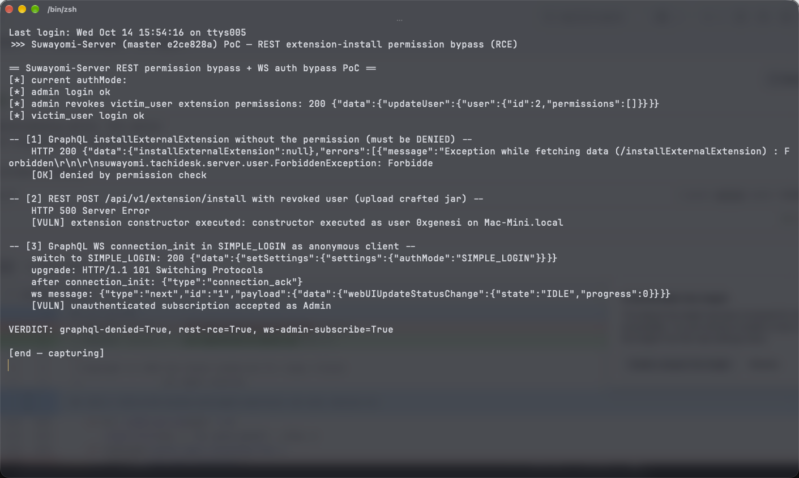

# REST Extension Install/Uninstall Endpoints Skip the Multi-User Permission Checks, Enabling Arbitrary Code Execution via Crafted Extension in Suwayomi-Server

| Field | Value |
|---|---|
| Project | [Suwayomi/Suwayomi-Server](https://github.com/Suwayomi/Suwayomi-Server) |
| Vulnerability Type | Incorrect Authorization (CWE-863) leading to Code Injection (CWE-94) |
| Severity | High — CVSS 3.1 Base Score: 8.8 |
| CVSS Vector | `AV:N/AC:L/PR:L/UI:N/S:U/C:H/I:H/A:H` |
| Affected Versions | Development branch with the new user/permission model (verified on master commit `e2ce828`, 2026-10-14; not yet in a tagged release as of v2.4.2366) |
| Authentication | Any logged-in user (UI_LOGIN) |

---

## Summary

The new multi-user permission model is enforced on the GraphQL API — `installExternalExtension` requires `INSTALL_EXTERNAL_EXTENSIONS`, and `updateExtension`'s install/uninstall patches require `INSTALL_EXTENSIONS` / `UNINSTALL_EXTENSIONS` (`server/src/main/kotlin/suwayomi/tachidesk/graphql/mutations/ExtensionMutation.kt`). The legacy REST endpoints that perform the same operations enforce nothing beyond "is logged in":

- `POST /api/v1/extension/install` (file upload) — `ExtensionController.installFile`, line ~90: only `requireUser()`
- `GET /api/v1/extension/install/{pkgName}` / `.../uninstall/{pkgName}` — same pattern

In a UI_LOGIN deployment where an administrator has revoked a user's extension permissions, that user's GraphQL calls are correctly rejected with `Forbidden`, but the identical operation through REST succeeds. Because installing an external extension ultimately instantiates an attacker-supplied class (`PackageTools.loadExtensionSourcesWithLockHeld` → `Class.forName(className, false, childFirstClassLoader).getDeclaredConstructor().newInstance()`), the bypass is arbitrary code execution as the server user.

## Details

`ExtensionController.kt` (master `e2ce828`), the upload endpoint:

```kotlin
behaviorOf = { ctx ->
    ctx.getAttribute(Attribute.TachideskUser).requireUser()   // "logged in" only
    val uploadedFile = ctx.uploadedFile("file")!!
    ctx.future {
        future {
            Extension.installExternalExtension(uploadedFile.content(), uploadedFile.filename())
        }
    }
},
```

Contrast the GraphQL mutation the upload replaces:

```kotlin
@RequireAuth
@RequirePermissions(UserPermission.INSTALL_EXTERNAL_EXTENSIONS)
fun installExternalExtension(input: InstallExternalExtensionInput): ...
```

`requireUser()` returns the user id for both `UserType.Admin` and `UserType.User` regardless of their permission lists. The extension load path then executes the uploaded jar's declared main class — for `.jar` files the `AndroidManifest.xml` is parsed from the archive as plain XML, so a two-entry jar (`AndroidManifest.xml` + one `.class`) with metadata `tachiyomi.extension.class=<classname>`, `tachiyomix.extensionLib=1.4`, `android:versionName="1.4.0"`, and `uses-feature tachiyomi.extension` passes all validation gates (feature presence, lib-version window 1.3–1.6) and its constructor runs on the server.

## PoC

Verified on a build of master commit `e2ce828` (Gradle `:server:installDist`), configured in `UI_LOGIN` mode with an admin and a `victim_user` account. The crafted extension jar is built with `javac` + `jar` plus a hand-written text `AndroidManifest.xml` — no Android toolchain involved.

**Step 1: admin revokes the user's extension permissions**

```
[*] admin revokes victim_user extension permissions: 200 {"data":{"updateUser":{"user":{"id":2,"permissions":[]}}}}
```

**Step 2: negative control — GraphQL install is denied by the permission directive**

```
-- [1] GraphQL installExternalExtension without the permission (must be DENIED) --
    HTTP 200 {"errors":[{"message":"... ForbiddenException: Forbidden ...
    [OK] denied by permission check
```

**Step 3: the same user uploads the crafted jar via REST**

```
-- [2] REST POST /api/v1/extension/install with revoked user (upload crafted jar) --
    HTTP 500 Server Error
    [VULN] extension constructor executed: constructor executed as user 0xgenesi on Mac-Mini.local
```

(The 500 is the post-install source-setup failing on the intentionally-minimal class — after the constructor has already run. The marker file `/tmp/SUWAYOMI_EXT_RCE.txt` written by the constructor proves execution.)

**Real-environment reproduction** (the product itself, run for this test): a live build of master `e2ce828` running in UI_LOGIN mode; the permission-revoked account's GraphQL upload was rejected while its REST upload of the crafted jar executed the constructor server-side, creating the marker file.



---

## Impact

Any authenticated user of a multi-user (UI_LOGIN) deployment — including accounts whose extension permissions were explicitly revoked — can execute arbitrary code on the server as the Suwayomi process user, by uploading a crafted `.jar` (or `.apk`) "extension". That reads/edits the entire library database, downloads directory, tracker credentials, and any file the process can reach; it also fully defeats the new permission model's install/uninstall gating.

### Remediation

1. Apply the same `@RequirePermissions` checks in the REST handlers: `INSTALL_EXTERNAL_EXTENSIONS` for `installFile`, `INSTALL_EXTENSIONS`/`UNINSTALL_EXTENSIONS` for install/uninstall by package name (`ExtensionController.kt`).
2. Preferably gate the REST surface behind a permission-preserving wrapper (reuse the GraphQL service functions, which already carry the checks) instead of calling `Extension.*` directly.
3. Add an authorization regression test that drives both the GraphQL and REST install paths with a permission-revoked user.
4. Longer term, treat uploaded extension code as untrusted (out-of-process execution or a signed-extension allowlist) — permission checks alone still leave install-privileged users with server-side code execution by design.
